# Work Dashboard: User Guide

Version 1.0.0. This guide walks through every part of the dashboard, one feature at a time, with a screenshot of each.

> **All screenshots use made-up demo data** (`demo/demo_data.py`, the persona "Alex"). No real calendar, reminder, note or Jira content appears anywhere in this repository. Each screenshot shows the whole page: the window is grown until no panel has anything left to scroll. To reproduce them, see [Regenerating the screenshots](#regenerating-the-screenshots).

The [README](../README.md) is the short reference (install, files, every config key). This guide is the long version: what you see, what each control does, and what each action changes.

## Contents

1. [Getting started](#1-getting-started)
2. [The screen at a glance](#2-the-screen-at-a-glance)
3. [Views](#3-views)
   - [Day](#day) · [Event panel](#event-panel) · [Meeting prep](#meeting-prep) · [Week](#week) · [Month](#month) · [Year](#year) · [Board](#board) · [Overdue](#overdue) · [Statistics: History](#statistics-history) · [Statistics: Ahead](#statistics-ahead) · [Weekly review](#weekly-review)
4. [Search, commands and quick capture](#4-search-commands-and-quick-capture)
5. [Creating things from the page](#5-creating-things-from-the-page)
   - [New reminders](#new-reminders) · [Plan blocks](#plan-blocks) · [New note](#new-note) · [Inbox triage](#inbox-triage) · [New Jira issue](#new-jira-issue)
6. [Timers](#6-timers)
   - [Countdown](#countdown) · [Focus timer with Jira worklog](#focus-timer-with-jira-worklog)
7. [The right panel](#7-the-right-panel)
8. [Settings and profiles](#8-settings-and-profiles)
9. [Data sources and health](#9-data-sources-and-health)
10. [iPad and iPhone](#10-ipad-and-iphone)
11. [Dark theme](#11-dark-theme)
12. [Keyboard shortcuts](#12-keyboard-shortcuts)
13. [What the dashboard may change](#13-what-the-dashboard-may-change)
14. [Troubleshooting](#14-troubleshooting)
15. [Regenerating the screenshots](#regenerating-the-screenshots)

---

## 1. Getting started

**Open it.** On the Mac: **http://127.0.0.1:8765** (bookmark it). The server runs in the background under launchd (`local.workdashboard`), starts at login and restarts itself if it stops.

**On the iPad or iPhone.** Through Tailscale: `tailscale serve` forwards to port 8765, so the Mac's Tailscale address opens the same page. In Safari, Share > Add to Home Screen opens it full screen as "Work". Each device enrols once with the access token link. See [iPad and iPhone](#10-ipad-and-iphone).

**Full screen on the Mac or iPad.** The full screen button in the toolbar (four corners, left of the right panel toggle) or `F` hides the browser's address bar, tabs and menu bar. `Esc`, `F` or the button bring them back. Browsers only allow full screen after a click or key press, so it never starts by itself when the page loads. `F` does nothing while you type in a field or a dialog is open. On the iPhone the button is hidden (Safari has no full screen for pages there).

**Try it without your data.** The demo serves the real `dashboard.html` with generated data, dates relative to today:

```bash
python3 demo/serve_demo.py      # then open http://127.0.0.1:8766
```

The demo writes nothing to disk and sends nothing anywhere. Board moves, new notes, capture, Inbox triage, new Jira issues, the focus timer and the countdown work in memory until the demo stops; Plan blocks, New reminders and Settings > Save are refused.

**How fresh is the data?** Calendar, Reminders and Jira are read every 5 minutes (`refresh_minutes`) and right after anything you create from the page. Obsidian edits show within about 20 seconds (the server watches file times every `obsidian.watch_seconds`). The Refresh button or the palette command "Refresh" reads everything now.

---

## 2. The screen at a glance

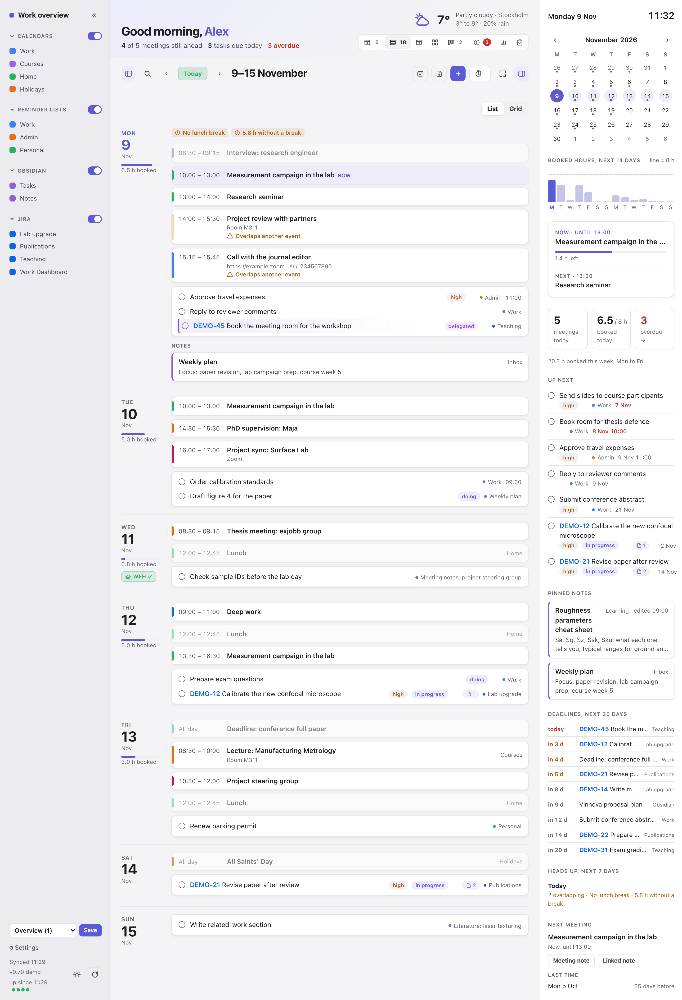

The page has four areas:

| Area | What is in it |
|---|---|
| **Greeting bar** (top) | Good morning/afternoon, how many meetings are still ahead, tasks due today, overdue count in red, and the local weather (Open-Meteo, only the coordinates leave the Mac). Today's date shows here only when the right panel clock is not visible. Under the weather sits the **view switcher**: icons for all eight views (Day, Week, Month, Year, Board, Overdue, Statistics, Weekly review) with counts as small badges (events today, events this week, Doing, and overdue in red); names appear when there is room. If the greeting is turned off, the switcher moves into the toolbar. |
| **Left sidebar** | Source sections **Calendars**, **Reminder lists**, **Obsidian**, **Jira** (per Epic), each with an on/off switch and one filter row per calendar, list or Epic; at the bottom the profile picker, Save, the version, and the four health dots. Sections fold. `[` hides the sidebar. |
| **Toolbar** | Left: sidebar toggle, search (magnifier), ‹ Today › and the period title. Right, aligned to the edge: Plan blocks, New note, **+ New reminder**, countdown (stopwatch), the focus timer chip when it runs, **full screen** (four corners; `F`) and the right panel toggle. |
| **Right panel** | Clock and month calendar, booked hours for the next 14 days, Now / Next, today's numbers, Up next, pinned notes, deadlines, heads-up warnings, next meeting. `]` hides it. See [The right panel](#7-the-right-panel). |

Colours carry meaning: each calendar, list and Epic keeps its own colour everywhere, except that Exchange meetings with an **Outlook category** take that category's colour, as in Outlook (the first category with a colour wins; text turns dark on pale colours); **red is used only for overdue**; amber marks warnings (overlaps, no lunch, long stretches).

---

## 3. Views

Switch with the view switcher under the weather, the keys `D` `W` `M` `Y` `B` `O` `S` `V`, or the palette. `←` `→` step to the previous or next period, `T` jumps to today.

### Day

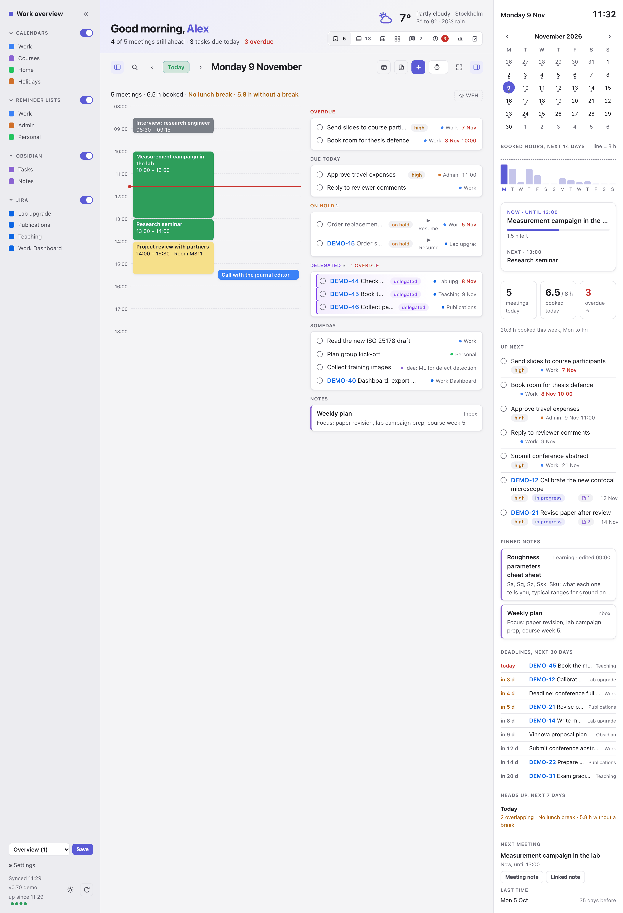

A timeline of the day with the current time as a red line. Meetings sit in the timeline; tasks are listed beside it in groups: **Overdue**, **Due today** and **Someday** (undated tasks), followed by **Notes** edited recently. The header shows the meeting count and booked hours, plus load warnings for the day ("No lunch break", "3.5 h without a break").

Every item is a link: a reminder opens in Apple Reminders, an Obsidian task or note in Obsidian, a Jira issue in Jira.

### Event panel

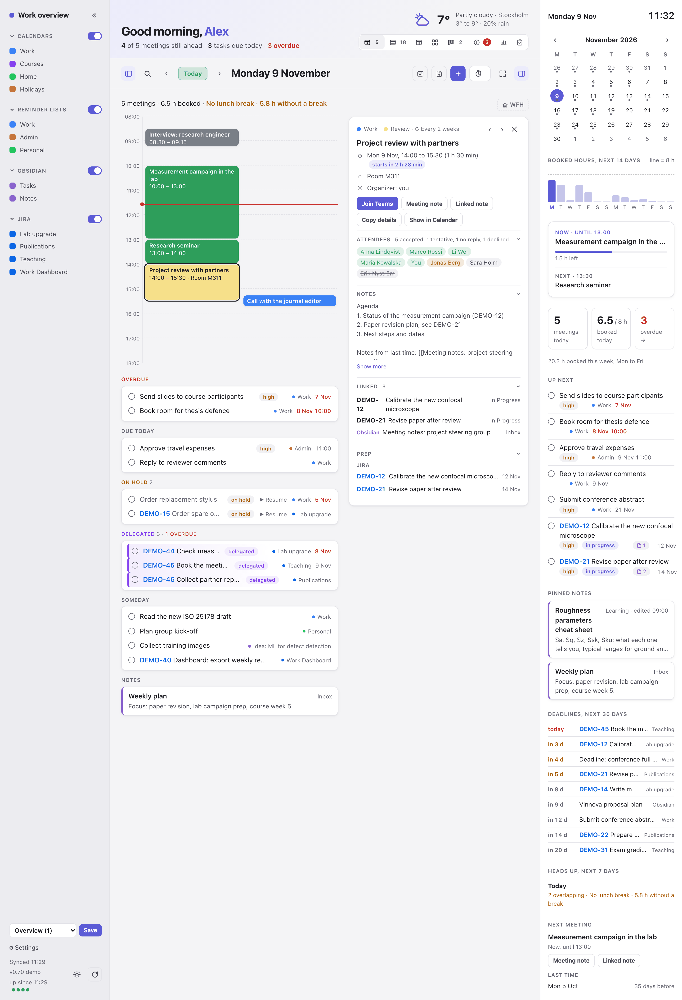

Click a meeting in the Day view and its details open in a panel beside the timeline. The panel stays open while you work and ‹ › step through the day's events; Esc or ✕ closes it.

It shows the time with a "starts in" badge, the recurrence, location, organizer, a **Join** button for Teams, Zoom or Meet links, **Meeting note**, **Copy details** and **Show in Calendar** (opens Calendar.app on that day; on iPad and iPhone the Calendar app). Below, foldable sections: **Attendees** with their RSVP answers, **Notes** with clickable links, and **Linked**: Jira issues and Obsidian notes that the event mentions.

Events that collide get "Overlaps another event". Copies of the same event from subscribed or course feed calendars (e.g. `MG2045-HT26`) collapse into one entry: your own entry plus one feed entry per slot with the room.

### Meeting prep

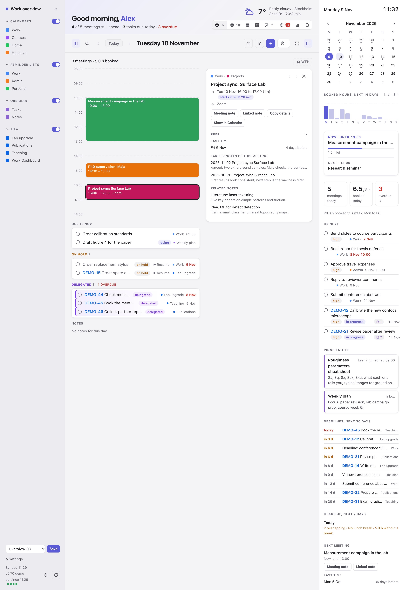

For a recurring meeting the panel adds **Prep**: when the series last took place, earlier notes of the series (notes named `YYYY-MM-DD Title`, which is what Meeting note creates), open Jira issues named in the event or belonging to an Epic named in its title, and related notes. The same information appears in the right panel block **Next meeting** for the next meeting today or tomorrow, with **Meeting note** (or **Open meeting note**) and **Linked note** buttons.

Related notes are explicit links only, so nothing unrelated shows up. A note belongs to a meeting when:

- its properties have `meeting: <meeting title>` (several meetings as a list; `meeting: "[[2026-11-05 Steering group]]"` also works, the date is ignored), or
- a meeting note of the series (`type: meeting`, `event: <title>`, as Meeting note writes) links to it with `[[...]]`, including notes outside the dashboard folders.

The match is on the series title (case, accents and punctuation ignored), so a note linked once shows for every occurrence. **Linked note** in the event panel or the Next meeting block creates a note with any template and writes `meeting:` for you.

**Meeting note** creates a note pre-filled with the date, time, place and attendees, in the meeting folder (`obsidian.meeting_folder`).

### Week


A **List / Grid** switch at the top picks the layout; the choice is kept per browser.

**List** is an agenda per day: meetings with time, place and Join link, then tasks due that day. Days of the current week that have already passed fold into a single "Show earlier day" row. Each day has a **load bar** (booked hours against a full day, set in Settings > Workday) and amber chips for overlaps, no lunch break or long stretches without a break.

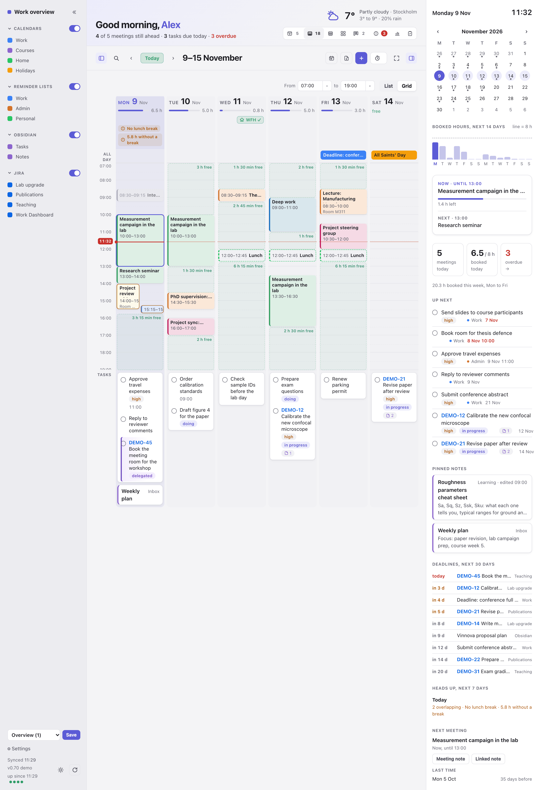

**Grid** is a time grid with the hours down the left. **From / To** above the grid set the hours shown (default 07:00 to 19:00): type a time in either field and press Enter or click away, or pick one from the half-hour list that opens when you click into the field or on ▾ (↑ / ↓ step 30 minutes). Any minute works, written as 7:30, 7.30, 0730, 730 or just 8; the end can be 24. The grid needs at least 30 minutes, and a time it cannot read is not applied (the field flashes red and goes back). Esc restores the field. Monday to Friday always show; Saturday and Sunday only when they hold something. Events sit at their times; overlapping events share the column width and get a warning outline. Events outside the hours shown are listed in the All day row with an up or down arrow and their start time. Gaps of an hour or more on weekdays (from now on, inside the hours shown) are marked "x h free"; events marked free, such as lunch, count as taken. A **red now line** runs across the week with the time at the hour column. Due tasks and notes sit in a row under the grid. Click an event to open its day with the event panel, or a day heading to open that day. In a narrow window the warning chips in each day heading fold into one warning mark with a count; hover it for the details.

### Month

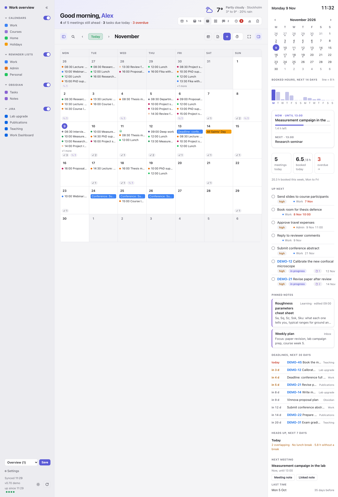

A calendar grid with meetings, all-day items and tasks per day, and a count of hidden items. Clicking a month in the Year view lands here.

### Year

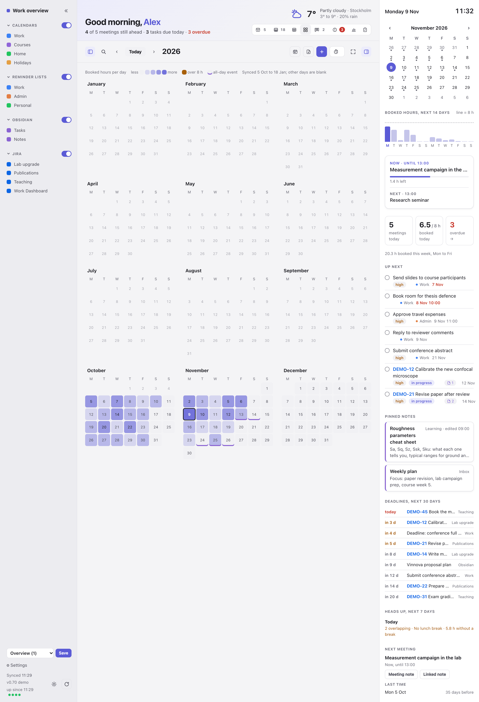

Twelve mini months, each day shaded by booked hours (legend at the top). All-day items such as holidays and vacations are marked. It is meant for spotting heavy and light periods at a glance. Click a month to open it.

### Board

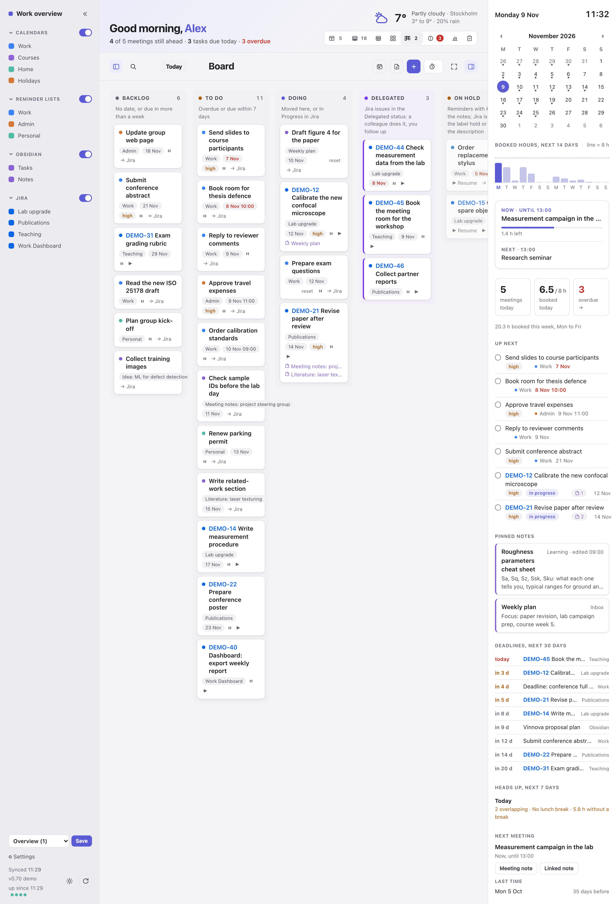

Four columns across every source: **Backlog**, **To Do**, **Doing**, **Done**.

- **Jira cards** follow their Jira status. Dragging one to another column changes the status in Jira (on touch screens, use ⇄). A Jira card has **▶** to start the [focus timer](#focus-timer-with-jira-worklog) and shows the two latest Obsidian notes that mention its key.
- **Reminder and Obsidian cards** are placed automatically (overdue or due within 7 days goes to To Do, the rest to Backlog). Moving them only changes the dashboard's own memory (`data/kanban.json`); the reminder or note is never touched. Done hides a task from the other views. These cards have **→ Jira** to turn them into a Jira issue.
- Done shows completed items from the last 14 days.

### Overdue

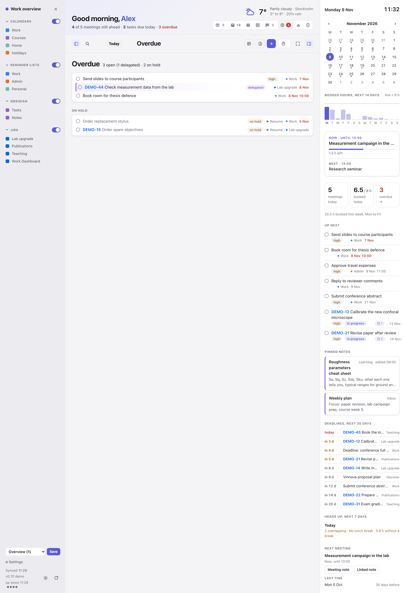

Everything with a due date in the past, from every source, oldest first. The red overdue counts in the greeting, on the view switcher and in the right panel link here.

### Statistics: History

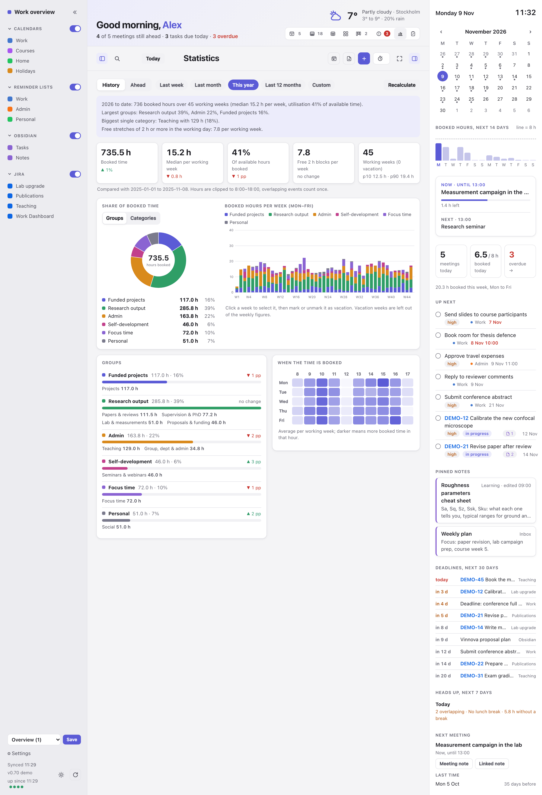

Where the calendar time went. Pick a period (Last week, Last month, This year, Last 12 months, or Custom). The top line is a plain-language summary; below are the key figures (booked hours, median per working week, utilisation, free 2 h focus blocks per week, working weeks) compared with the previous period.

The donut shows the share of booked time by **Group** or **Category**; the bar chart shows booked hours per week, stacked by group. Click a week to mark it as vacation, so it is left out of the weekly figures.

Categories come from rules on event titles (`config.json` > `stats.groups`, regular expressions, first match wins). A category name in brackets at the end of a title wins over the rules: "Report writing [Projects]". `Absence` marks time off, `Ignore` is not counted, anything unmatched is `Uncategorized`. Only the aggregates reach the page.

### Statistics: Ahead

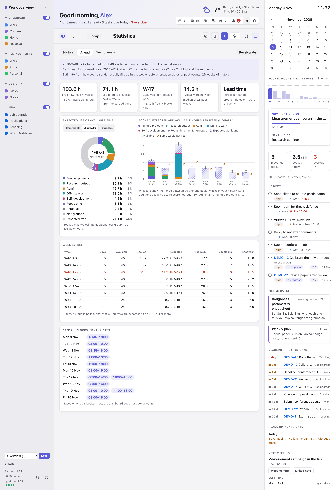

The next 8 weeks. For each week: hours available, hours booked now, and the **expected** load, which adds the late additions your calendar usually gets at that lead time (learned from the creation dates of the last 26 weeks of events). The summary names the best week for focused work. The donut shows how the available time is expected to be used; the chart shows booked, expected and free hours per week, with whiskers for the spread between quieter and busier weeks.

If fewer than 60% of past events have a usable creation date, Ahead uses recent comparable weeks instead and says so.

### Weekly review

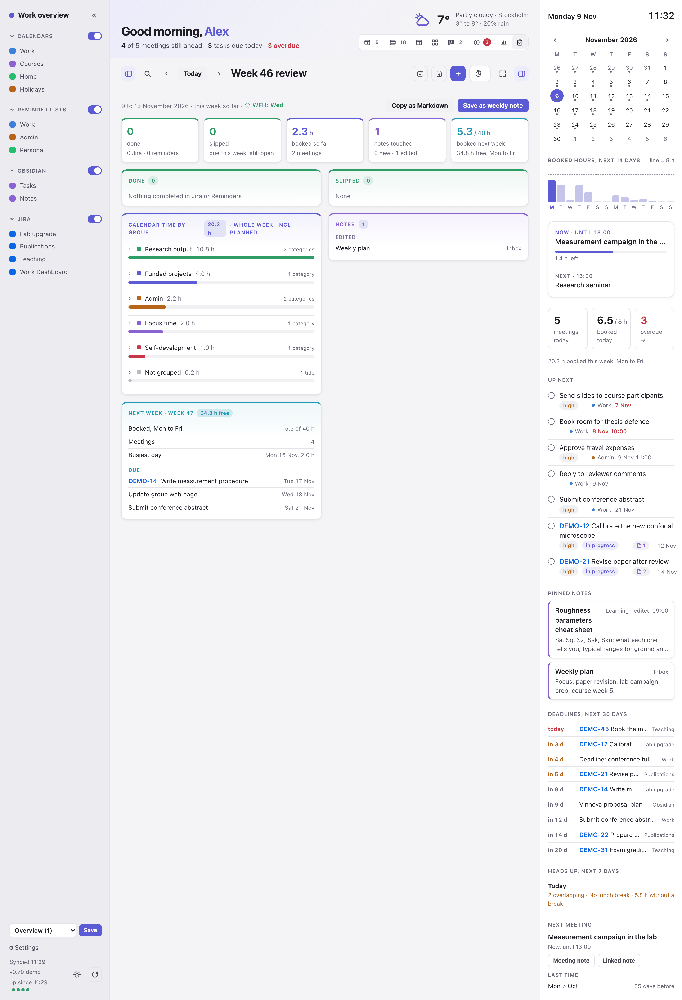

One page per ISO week (‹ › step by week): figures at the top (done, slipped, booked hours, meetings, notes touched, booked next week), then **Done** (Jira and reminders), **Slipped**, **Calendar time by group**, **Notes** created and edited, and **Next week**.

- **Copy as Markdown** puts the review on the clipboard.
- **Save as weekly note** writes `YYYY-Www Weekly review` into `obsidian.review_folder` (default `Inbox/WorkDashboard`). The note is visual: the numbers as frontmatter properties (so Obsidian Bases can compare weeks; `Weekly reviews.base` sits in the same folder), a summary callout, a Mermaid pie of hours by group, a Mermaid chart of hours per day, callouts for Done, Slipped, Notes and Next week, and an empty Reflection section to fill in.
- **Automatic:** with `obsidian.review_auto` on, the review writes itself after Friday at `review_auto_hour` (16:00) the next time any page is open, once per week, never over an existing note.

Calendar content in the review stays at group level (hours per group and per day); no meeting titles.

---

## 4. Search, commands and quick capture

### Search and commands

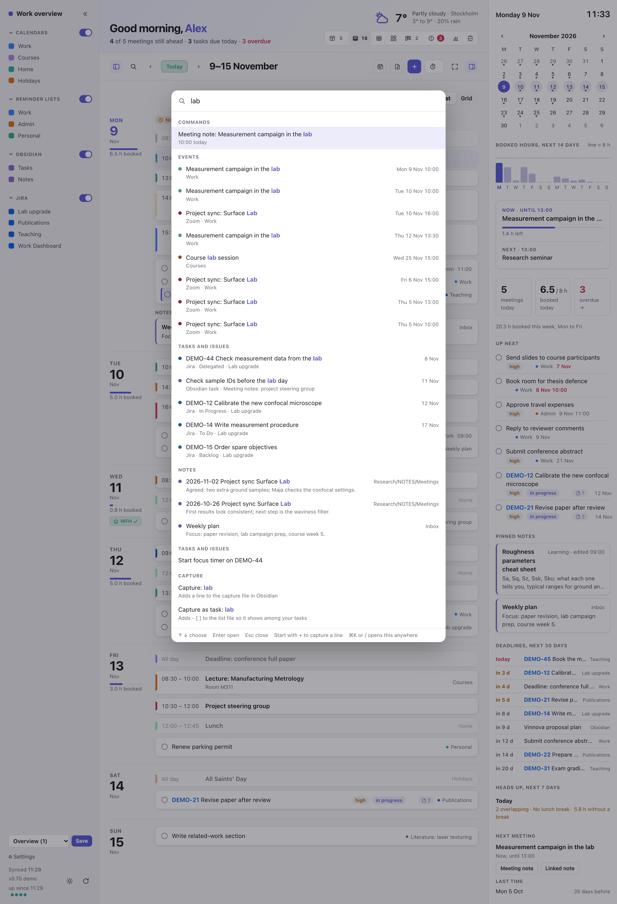

`⌘K` (or `/` when not typing, or the magnifier) opens the palette.

- **Empty**, it lists every command with its shortcut: views, Today, New reminder, New note, Plan blocks, Countdown, Refresh, Data sources, Settings, side panels, theme, each profile, and Meeting note for the next meeting.
- **Typing** searches commands, **events** (title, place, calendar, organizer, attendees, notes; upcoming first), **tasks and issues**, **notes** (title, folder, excerpt) and, from the server, **In note text**: the full text of every note in the folders the dashboard reads, with the matching line. Word order, case and accents do not matter (`ytmatning` finds `ytmätning`).
- `↑` `↓` choose, Enter runs or opens, Esc closes. Enter on an event opens it in the Day view with its panel.

### Quick capture

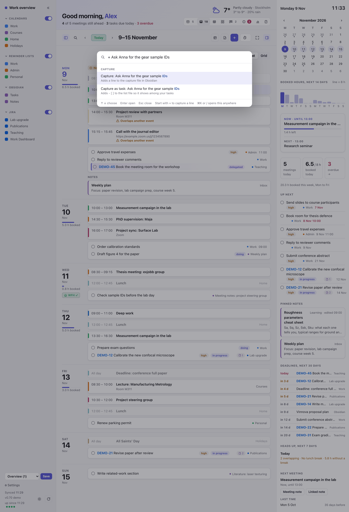

Start the text with **+** and Enter:

- **Capture** appends `- YYYY-MM-DD HH:MM text` to `Inbox/WorkDashboard/Capture from Work Dashboard.md` (`obsidian.capture_text_file`).
- **Capture as task** appends `- [ ] text` to `Inbox/WorkDashboard/List from Work Dashboard.md` (`obsidian.capture_task_file`); it then appears among your tasks.

Every search also offers to capture what you typed. Capture only ever appends one line; a missing file is created with a heading.

---

## 5. Creating things from the page

Every dialog closes with Esc. Everything the dashboard creates is tagged, so it can undo its own last batch and nothing else.

### New reminders

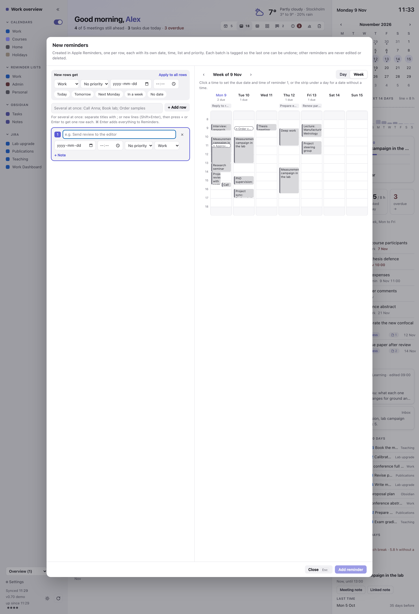

`R`, `N` or **+**. One row per reminder, each with its own list, priority, date and time and notes. The **New rows get** line sets defaults for new rows (Today, Tomorrow, Next Monday, In a week, No date). The box at the top takes several titles at once, separated by `;` or new lines ("+ Add 3 rows").

On the right, a day or week calendar shows your events: click a time to place the selected row there, or to add a new row at that time. **Add reminders** creates them in Apple Reminders in one go; rows that fail stay in the dialog. **Undo** removes the last batch (only reminders it created and that are still open). The draft is kept if you close the dialog.

### Plan blocks

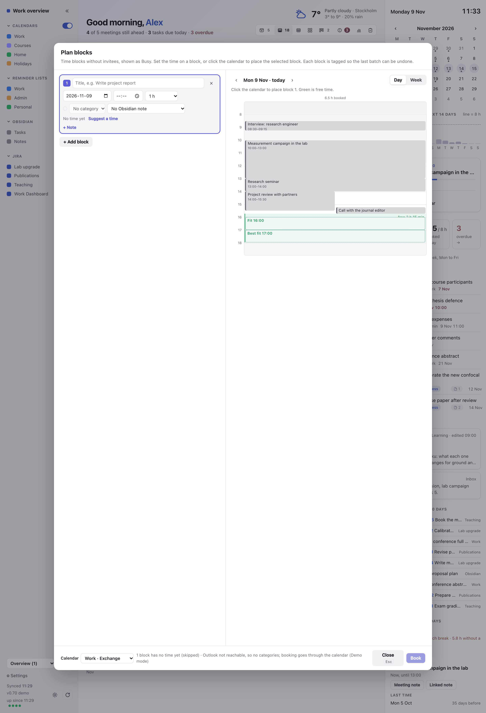

`P` or the toolbar. Time blocking: one card per block with a title, date, start, length, notes and an **Outlook category**. Set the time by hand or click the calendar on the right, which shows your events and the free bands (green). **Suggest a time** ranks free slots by fit, buffer around meetings (`planner.buffer_minutes`), the day's load and your habits.

The **Obsidian note** choice on a card creates a note when the block is booked: **Meeting note** makes the meeting note (`YYYY-MM-DD Title`), **Linked note** makes a note from any template with `meeting: <title>`. Either way it shows under Related notes for that meeting. Undo removes the events but keeps the notes.

**Book** creates the blocks as Busy. Blocks for the Exchange calendar (`planner.outlook_calendar`) are booked through Microsoft Outlook so the category is set (EventKit cannot set categories); other calendars go through EventKit. Outlook-created blocks appear on the page after Exchange syncs. **Undo** removes only the events of the last batch. **Discard** clears the draft.

### New note

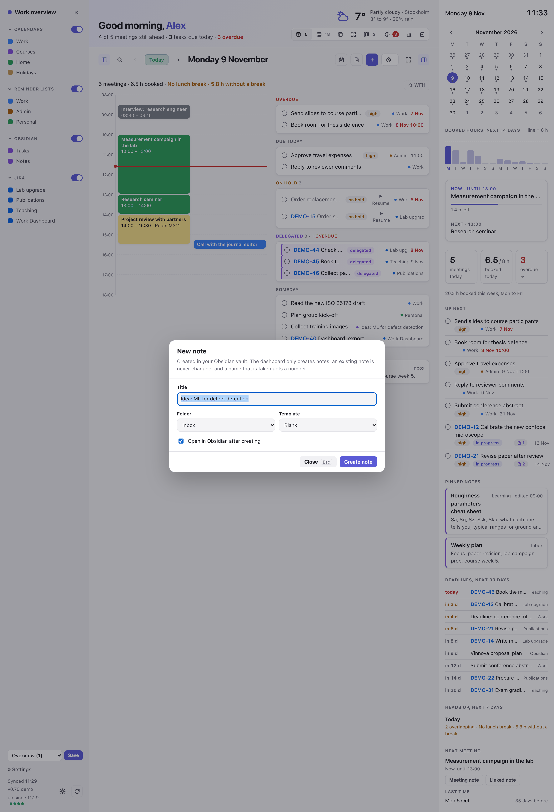

`Shift N`, the toolbar, or **Meeting note** in the event panel. Title, folder (only folders the dashboard may write to, `obsidian.write_folders` and their subfolders), and template: Meeting, Idea, Literature, Blank, or any `.md` in the vault's `Templates` folder (`{{title}}`, `{{date}}`, `{{time}}` are filled in). "Open in Obsidian after creating" jumps straight to it.

New note is create-only: a name that is taken gets " 2", nothing is ever overwritten.

### Inbox triage

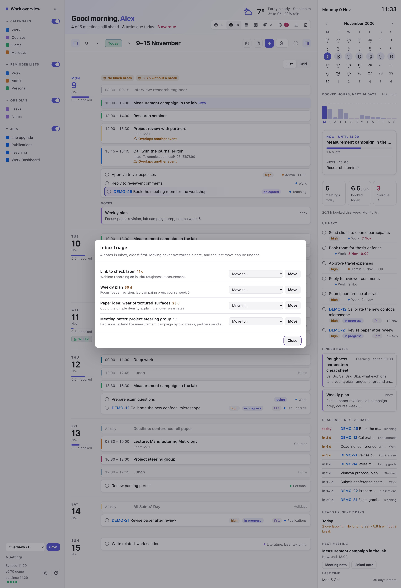

`I` or the palette. The notes in the Inbox folder, oldest first, with their age (amber from 14 days) and first line. Pick a folder and **Move**. Only Inbox notes can be moved, only into allowed folders, never onto an existing note. **Undo last move** puts the last one back. The capture files are not listed.

### New Jira issue

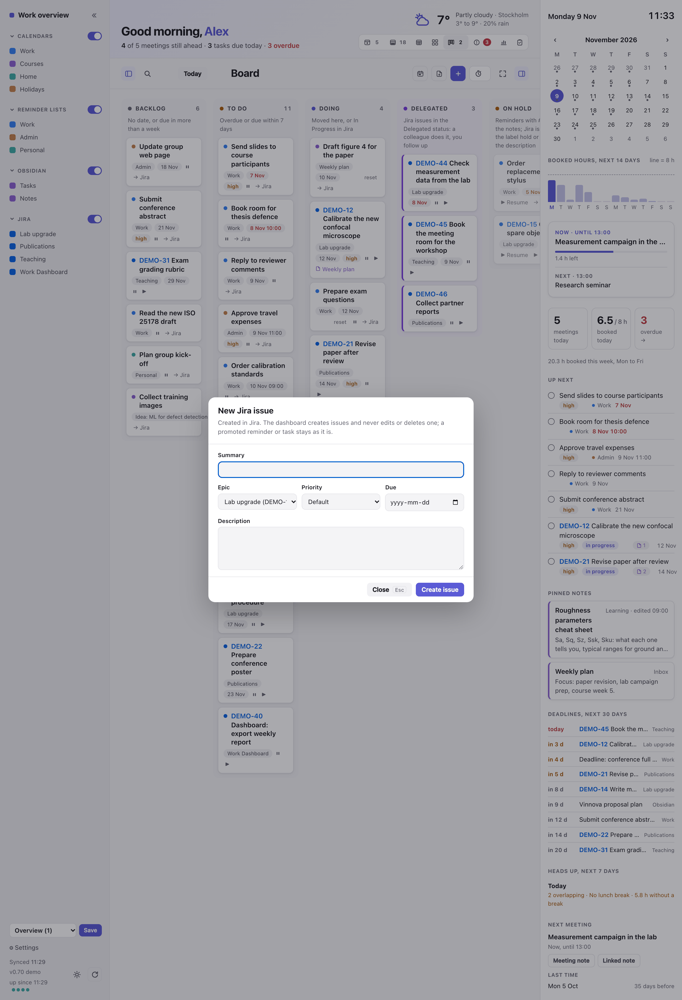

`J`, the palette, or **→ Jira** on a reminder or Obsidian card on the Board. Summary, Epic (open Epics of the project; `jira.default_epic` is preselected), priority, due date and description. When you promote a reminder or task, the issue gets its notes, due date, priority and, for an Obsidian task, a link back to the note; the original is not changed. Create-only.

---

## 6. Timers

Both timers live on the server, so the Mac, iPad and iPhone show the same one.

### Countdown

| Setting it | Running |
|---|---|
| 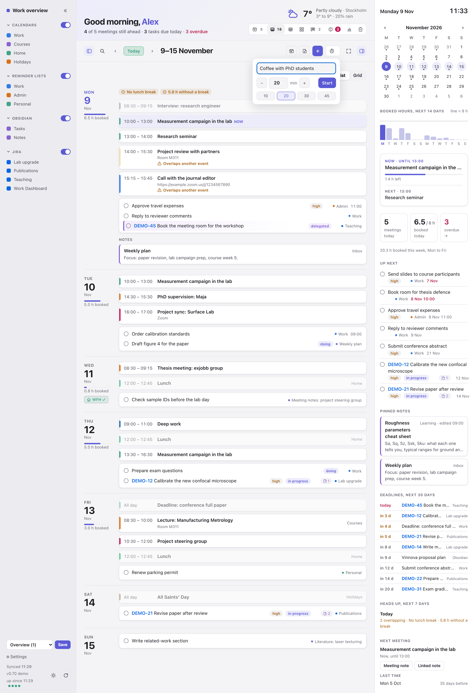 | 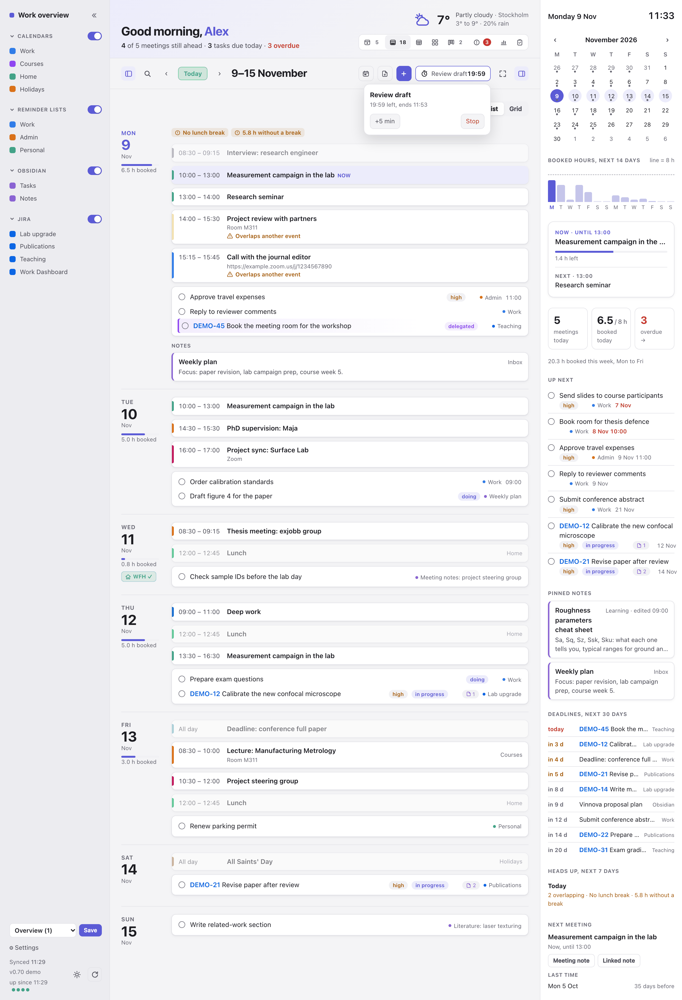 |

The stopwatch button in the toolbar, `A`, or "Countdown" in the palette. Type what it is for, set the minutes (default 20; − / + by 5; quick 10, 20, 30, 45; the last value is remembered per browser) and **Start**.

While it runs the button shows the text and time left with a progress fill; click it for **+5 min** or **Stop**. When it ends the button turns red and pulses, the tab title shows ⏰, open pages beep every 2 s for up to a minute, and the Mac shows a notification with a system sound (`alarms.mac_sound`), even with no browser open. One click on the red button stops it everywhere. One countdown at a time; starting a new one replaces it.

On iPad and iPhone the page can only beep after one tap on it since it was opened (a browser rule).

### Focus timer with Jira worklog

| Running on a Jira issue | Stopping and logging |
|---|---|
| 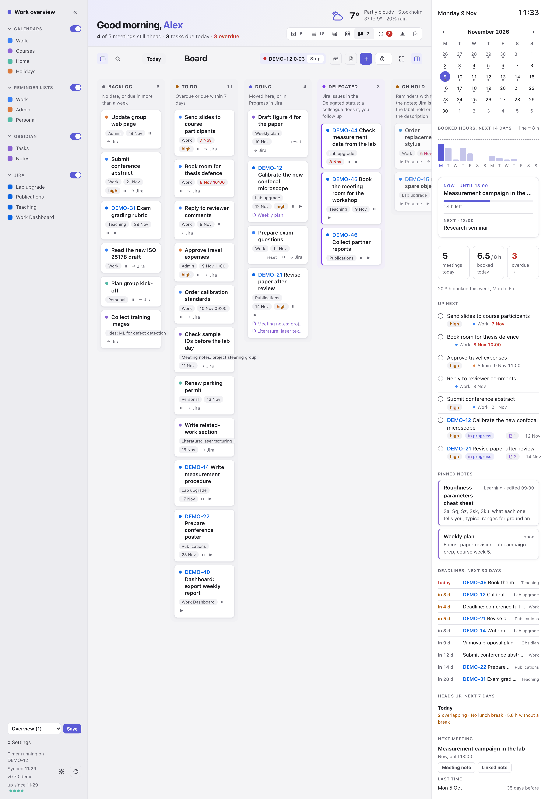 | 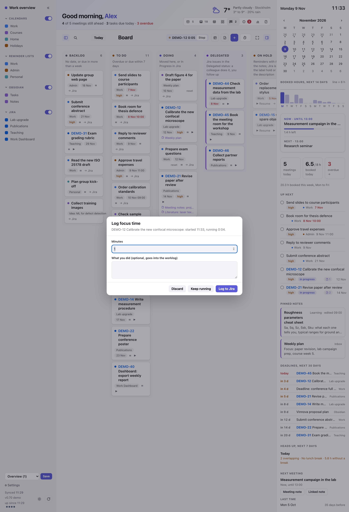 |

**▶** on a Jira card on the Board, or "Start focus timer" in the palette. A chip in the toolbar shows the issue key and the elapsed time. **Stop** opens a dialog with the minutes prefilled and an optional comment; **Log to Jira** posts a worklog to that issue. **Keep running** closes the dialog, **Discard** stops without logging anything.

---

## 7. The right panel

Visible in every screenshot above, from top to bottom by default:

| Block | What it shows |
|---|---|
| **Date and time**, **Month calendar** | Today and the current month at a glance. |
| **Booked hours, next 14 days** | One bar per day against the full-day line. |
| **Now / Next** | The current meeting with time left, or the next one with "in 35 min", and overlap warnings. |
| **Today's numbers** | Meetings today, booked hours against a full day, overdue (links to Overdue). |
| **Hours booked this week** | Against the week's capacity. |
| **Up next** | The next tasks by due date. |
| **Pinned notes** | Notes with the `#dashboard` tag. |
| **Deadlines, next 30 days** | Countdown (red within 2 days, amber within 7) from Jira due dates, note frontmatter `due:` or `deadline:`, and events or reminders whose title says deadline, due, submission, frist, sista dag, last day, inlämning or closes. |
| **Heads up, next 7 days** | Overbooked days, overlaps, no lunch break, long stretches. Click a day to open it. |
| **Next meeting** | Meeting prep for the next meeting today or tomorrow. |

Hover a block (always visible on touch) for three controls: a **grip** to drag it up or down, a **chevron** to fold it, **✕** to hide it. Order and hiding are saved in the current profile; folding is remembered per browser, so the iPad and the Mac can fold differently.

---

## 8. Settings and profiles

`,` or the gear. A **profile** is what the page looks like when it opens; **Workday** and **Data** apply to all profiles.

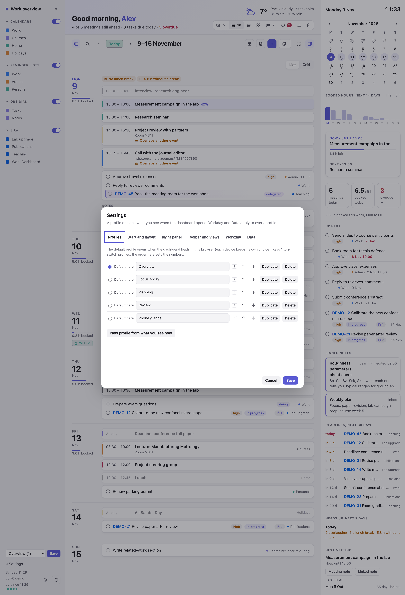

**Profiles.** Five starters: Overview, Focus today, Planning, Review, Phone glance. Duplicate, rename, reorder, delete, or "New profile from what you see now". Choose which one this browser opens with (Default here). Keys `1` to `9` switch profiles; the sidebar footer has a picker and **Save** to store the current filters and layout into the active profile. Profiles are stored on the Mac (`data/profiles.json`), so every device sees the same set.

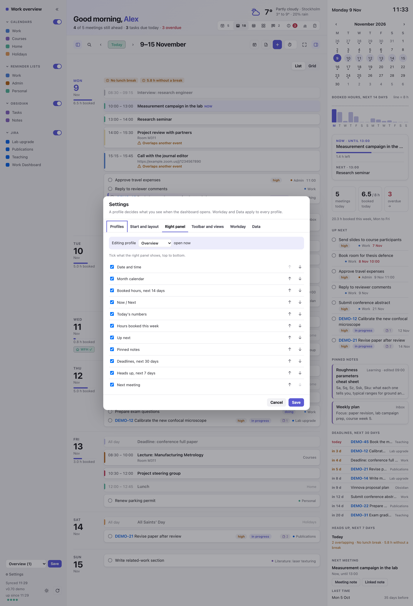

**Start and layout** (start view, side panels and widths, theme), **Right panel** (which blocks, in which order; brings hidden blocks back), **Toolbar and views** (buttons, view names, phone tab bar, Week and Day details such as load bars, overlap marks and load warnings).

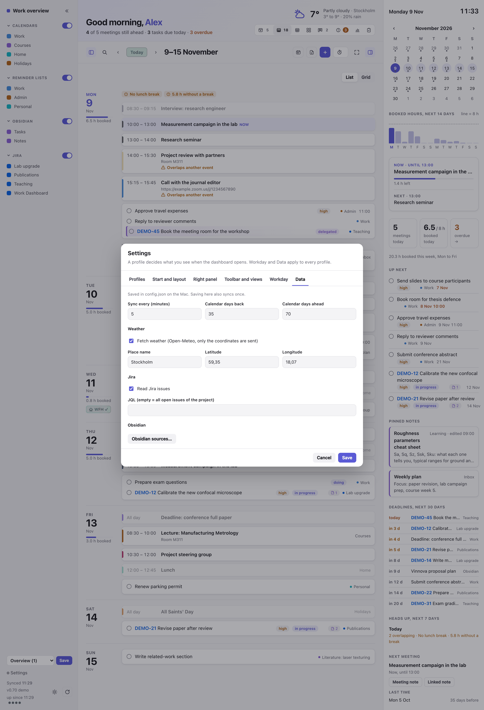

**Workday**: the hours of a full day (drives load bars and "/ 8 h"). **Data** edits a safe part of the live `config.json` on the Mac: sync interval, calendar days back and ahead, weather place and coordinates, Jira on/off and JQL, work hours, and **Obsidian sources** (which folders and files are read). Everything else is edited in the live config; see the README for every key.

---

## 9. Data sources and health

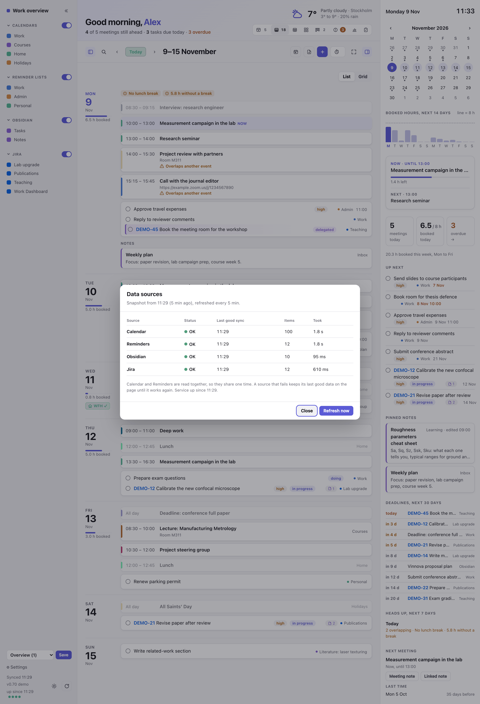

The four dots at the bottom of the sidebar (Calendar, Reminders, Obsidian, Jira) are green when the last read worked. Click them for **Data sources**: state, last good sync, number of items and read time per source, and **Refresh now**.

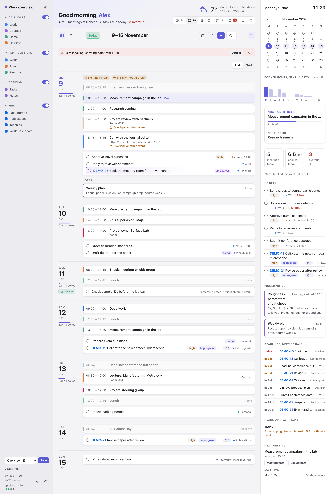

When a source fails, its dot turns red, a banner above the view says which one ("Jira is failing, showing data from 13:22") with **Details**, and the panel shows the error and a hint to fix it. A failing source **keeps its last good data** on the page, so a Jira outage never blanks your calendar. The banner can be hidden until something changes.

---

## 10. iPad and iPhone

| Today | Week |
|---|---|
| 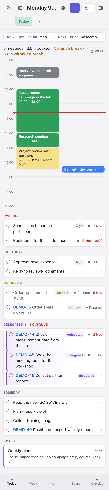 | 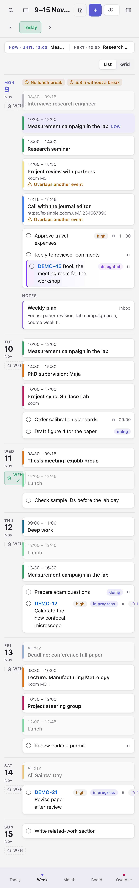 |

On narrow screens the side panels become drawers and a **tab bar** appears at the bottom (Today, Week, Month, Board, Overdue; choose the tabs in Settings > Toolbar and views). The Now / Next card and today's numbers sit at the top. The "Phone glance" profile is set up for this.

**Narrow windows.** At 900 px wide or less (a Mac window beside other apps, iPad Split View) the page goes slim: the greeting is one line with the weather as icon and temperature, the toolbar is lower, and Now / Next becomes a one-line strip, so the week starts much higher on the page. Wider windows show the full header again.

**Access token.** Every request needs a token, a second layer behind `tailscale serve`. On the Mac, `update.sh` opens the enrolment link. For the iPad or iPhone, run `auth.py show` on the Mac (in `~/Library/Application Support/WorkDashboard/`, with its `.venv` Python) and open the link once on the device; the page then keeps a cookie for about a year. `auth.py rotate` makes a new token and every device enrols again.

**Full screen.** On the iPad the full screen button works as on the Mac. On the iPhone it is hidden; Add to Home Screen gives a page without browser bars instead.

Links open the native apps: Reminders, Obsidian (the vault name in `obsidian.vault_name` must match on the device), Jira, and Show in Calendar opens the Calendar app on the event's day. The countdown and focus timer are shared with the Mac.

---

## 11. Dark theme

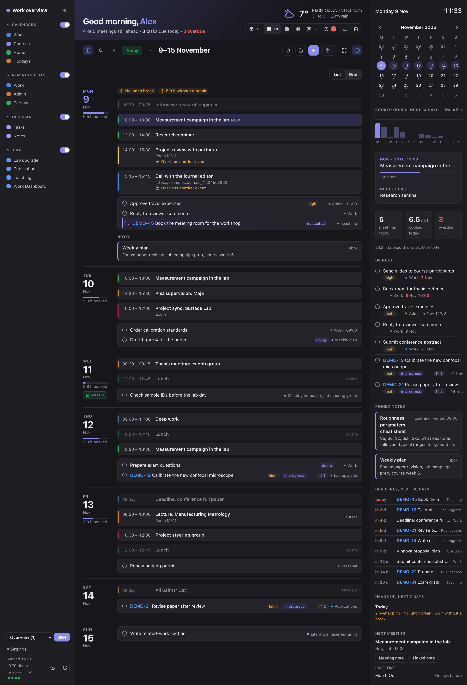

Follows the system by default; set Light, Dark or System per profile in Settings > Start and layout, or toggle it from the palette.

---

## 12. Keyboard shortcuts

| Key | Action |
|---|---|
| `⌘K` or `/` | Search and commands |
| `D` `W` `M` `Y` `B` `O` `S` `V` | Day, Week, Month, Year, Board, Overdue, Statistics, Weekly review |
| `T` | Today |
| `←` `→` | Previous / next period |
| `R` or `N` | New reminders |
| `Shift N` | New note |
| `J` | New Jira issue |
| `I` | Inbox triage |
| `P` | Plan blocks |
| `A` | Countdown |
| `,` | Settings |
| `1` to `9` | Switch profile |
| `[` `]` | Left / right panel |
| `F` | Full screen on / off |
| `Esc` | Close the open dialog, the event panel or a drawer. In the dashboard's own full screen (`F`), Esc also leaves full screen; Safari's window full screen (Ctrl ⌘ F) is not affected |

---

## 13. What the dashboard may change

The dashboard reads everything and changes almost nothing. It never edits or deletes anything it did not create, with these exact exceptions:

| Source | May do | Never does |
|---|---|---|
| **Calendar** | Create Plan blocks; Undo removes the events of its own last batch (tag in the notes plus stored id) | Edit or delete any other event |
| **Reminders** | Create reminders; Undo removes open reminders of its own last batch | Edit, complete or delete any other reminder |
| **Obsidian** | Create new notes and the weekly review (create-only); append one line to the two capture files; move notes out of the Inbox folder into allowed folders (never onto an existing file, last move undoable) | Edit, overwrite or delete any note |
| **Jira** | Change status when you drag a card; create issues; post worklogs from the focus timer | Edit or delete an issue |

Data stays on the Mac: the server listens on 127.0.0.1 only (Tailscale forwards to it), and every request needs the access token (Keychain `WorkDashboard-access`). The only outbound traffic is the Jira API and the weather request (coordinates only). The Jira token is in the macOS Keychain. Snapshots, `data/` and the personal `config.json` are never committed to Git.

---

## 14. Troubleshooting

| Symptom | Fix |
|---|---|
| A red dot or banner | Click it: Data sources shows the error and a hint. |
| Calendar or Reminders denied | System Settings > Privacy & Security > Calendars / Reminders > enable WorkDashboard. |
| Exchange calendar missing | It must be added in System Settings > Internet Accounts; an account added only inside BusyCal is invisible to EventKit. |
| "Could not write the note", capture or move failed | The folder must be in `obsidian.write_folders` (or the read folders) and synced by your cloud drive. |
| Jira errors | Data sources shows whether the token works. Store a new one: `security add-generic-password -U -s work-dashboard-jira -a <email> -w '<token>'`. |
| Meetings keep their calendar colour instead of the Outlook category | Microsoft Outlook must be installed and running for the Exchange account, `calendar.category_colors` and `planner.outlook` must be on; colours appear after the next harvest. |
| Plan block booked but not on the page | Outlook-created blocks appear after Exchange syncs (usually a minute or two). |
| No beep on iPad / iPhone | Tap the page once after opening it. |
| Page does not load | Restart: `launchctl kickstart -k gui/$(id -u)/local.workdashboard`. Logs: `~/Library/Application Support/WorkDashboard/logs/err.log`. |

---

## Regenerating the screenshots

The images in `docs/guide/` come from the demo server and `demo/guide_shots.py` (Python Playwright with Chromium, 1440 wide at 2×, plus an iPhone 13 profile). Each shot starts at 1440 × 900 (or the iPhone screen) and the window grows taller until no scroll area hides anything (main column, sidebar, right panel, an open dialog), up to 4000 px, so every image shows the whole dashboard:

```bash
python3 demo/serve_demo.py &
python3 demo/guide_shots.py                          # all shots
python3 demo/guide_shots.py http://127.0.0.1:8766/ 08-board 12-weekly-review   # only some
```

The README images in `docs/screenshots/` are made by `demo/screenshots.mjs` (headless Google Chrome, no npm packages; `CHROME=/path/to/chrome` for another Chromium), with the same whole-page sizing. Only demo data goes into screenshots.
